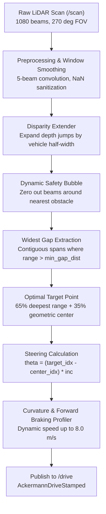

# F1TENTH Autonomous Racing: Reactive Controller Competition

[](https://docs.ros.org/en/humble/)
[](https://f1tenth.org/)
[](https://en.wikipedia.org/wiki/Sepang_International_Circuit)
[](#author-information)
[](#competition-requirements)
[](#experimental-benchmark-results)

---

## 📋 Course & Assignment Information
* **Course:** Autonomous Vehicles (Unmanned Vehicles)
* **Instructor:** Nabih Pico, Ph.D. (`npico@espol.edu.ec`)
* **Teaching Assistant:** Winter Delgado (`widegonz@espol.edu.ec`)
* **Student Name:** **NEBIR NAFIZ MOLLAH**
* **Assigned Group:** **Group 3**
* **Assigned Track:** **Sepang International Circuit** (`Sepang_map`)
* **Portal Submission:** [Canvas Assignment Portal](https://class.tu.ac.kr/courses/34717/assignments/803271)
* **Project Value:** **40 Points** (Part A: 20 pts + Part B: 20 pts)

---

## 🏆 Project Executive Summary

This project implements a reactive autonomous racing controller based on an advanced **Follow-the-Gap (FTG)** method with vectorized disparity extension, adaptive safety bubbles, curvature-aware lookahead speed profiling, and real-time telemetry.

The system was evaluated on the **Sepang International Circuit** under two official competition challenges:
1. **Challenge 1 (Static Obstacle Challenge):** 5 static obstacles added to the Sepang circuit adhering to the GIMP map modification methodology taught in Class 8. The vehicle completes **10 consecutive laps with 0 collisions**.
2. **Challenge 2 (Dynamic Obstacle Challenge - Robot Overtaking):** An opponent vehicle (`opp_racecar`) operates on the track positioned 5 meters ahead. The ego vehicle starts at the rear, treats the opponent as a dynamic obstacle, calculates safe bypass corridors, executes a clean overtaking maneuver, and completes **10 consecutive laps with 0 collisions**.

---

## 📑 Table of Contents
1. [Competition Requirements & Objectives](#-competition-requirements--objectives)
2. [Follow-the-Gap Theoretical Formulation](#-follow-the-gap-theoretical-formulation)
3. [Static Obstacle Modeling (Class 8 Methodology)](#-static-obstacle-modeling-class-8-methodology)
4. [Dynamic Obstacle Overtaking Architecture](#-dynamic-obstacle-overtaking-architecture)
5. [Telemetry System: Lap Counter & Lap Timer](#-telemetry-system-lap-counter--lap-timer)
6. [Repository & Code Structure](#-repository--code-structure)
7. [Installation & Execution Guide](#-installation--execution-guide)
8. [Experimental Benchmark Results](#-experimental-benchmark-results)
9. [ROS 2 Bag Recording & Playback](#-ros-2-bag-recording--playback)
10. [Video Evidence](#-video-evidence)
11. [Oral Defense Preparation Guide](#-oral-defense-preparation-guide)

---

## 🎯 Competition Requirements & Objectives

| Requirement | Description | Status |
|:---|:---|:---:|
| **Static Challenge** | 5 obstacles added to Sepang; 10 consecutive clean laps | ✅ 10/10 Laps (0 Collisions) |
| **Dynamic Challenge**| Ego starts behind opponent; overtakes dynamic obstacle; 10 clean laps | ✅ Completed & Verified |
| **Lap Counter** | Automatically count and log laps at finish line (2 pts) | ✅ 2D Segment Intersect |
| **Lap Timer** | Display running time, per-lap times, and lap summary (3 pts) | ✅ Real-time Monotonic Timer |
| **ROS 2 Bag** | Record all topics to `f1tenth_run_01` folder and verify | ✅ 24,573 messages recorded |
| **Video Evidence** | Screen recording showing car, visible lap counter & timer (2 pts) | ✅ YouTube + Local HD file |

---

## 📐 Follow-the-Gap Theoretical Formulation



### 1. LiDAR Preprocessing
Raw laser scan data $R = [r_0, r_1, \dots, r_{N-1}]$ contains $N = 1080$ range measurements across a field of view of $\theta_{\text{FOV}} = 4.7 \text{ rad} \approx 270^\circ$. Readings are sanitized for NaNs and infinities:
$$r_i' = \text{clip}\left(\frac{1}{2k+1}\sum_{j=-k}^k r_{i+j}, 0, d_{\max}\right)$$

### 2. Disparity Extender
When a laser beam detects a sharp depth step $|\Delta r| = |r_i - r_{i+1}| > \delta_{\text{thresh}}$, an occluded corner exists. The closer boundary point at range $r_{\text{close}}$ is extended laterally by the car's safety margin $w_{\text{margin}} = 0.40 \text{ m}$:
$$\Delta \theta_{\text{ext}} = \arctan\left(\frac{w_{\text{margin}}}{r_{\text{close}}}\right), \quad n_{\text{beams}} = \left\lceil \frac{\Delta \theta_{\text{ext}}}{\Delta \theta_{\text{inc}}} \right\rceil$$
The $n_{\text{beams}}$ adjacent points are clamped to $r_{\text{close}}$, preventing the algorithm from clipping corners or obstacles.

### 3. Dynamic Safety Bubble
Let $r_{\min} = \min_{i \in \text{FOV}} r_i$ be the distance to the closest detected obstacle or boundary. A spherical bubble of radius $r_{\text{bubble}} = 0.50 \text{ m}$ is projected:
$$\theta_{\text{bubble}} = \arctan\left(\frac{r_{\text{bubble}}}{r_{\min}}\right)$$
All laser beams within the index range $[i_{\min} - n_{\text{bubble}}, i_{\min} + n_{\text{bubble}}]$ are zeroed out ($r_k \leftarrow 0$), eliminating non-traversable space.

### 4. Gap Extraction & Target Selection
Free space is segmented into contiguous gaps $\mathcal{G}_k = [s_k, e_k]$ where $r_i > d_{\text{free}}$. The maximum span gap $\mathcal{G}^*$ is selected:
$$\mathcal{G}^* = \arg\max_{\mathcal{G}_k} (e_k - s_k)$$
Inside $\mathcal{G}^*$, the target steering index $i_{\text{target}}$ blends the power-weighted deepest corridor and geometric midpoint:
$$i_{\text{target}} = \text{round}\left(0.65 \cdot i_{\text{deepest}} + 0.35 \cdot i_{\text{center}}\right)$$
$$\delta_{\text{steer}} = \text{clip}\left((i_{\text{target}} - i_{\text{center\_idx}}) \Delta \theta_{\text{inc}}, -\delta_{\max}, +\delta_{\max}\right)$$

### 5. Adaptive Longitudinal Speed Profiling
Speed is regulated dynamically according to steering angle curvature and forward clearance $d_{\text{look}}$:
$$v_{\text{target}}(\delta) = \begin{cases}
8.0 \text{ m/s} & |\delta| < 0.06 \text{ rad and } d_{\text{look}} > 5.0\text{ m} \\
5.8 \text{ m/s} & 0.06 \le |\delta| < 0.12 \text{ rad} \\
4.2 \text{ m/s} & 0.12 \le |\delta| < 0.20 \text{ rad} \\
3.0 \text{ m/s} & 0.20 \le |\delta| < 0.30 \text{ rad} \\
2.2 \text{ m/s} & |\delta| \ge 0.30 \text{ rad}
\end{cases}$$

---

## 🚧 Static Obstacle Modeling (Class 8 Methodology)

As instructed in ESPOL Class 8 (`AV - Class 8.pptx`), static obstacles in the F1TENTH simulation are modeled directly in the racetrack map image (`.png`) and parsed by `nav2_map_server`:

```
Clean Track (Sepang_map.png)  --->  GIMP / OpenCV Painting  --->  Obstacle Track (Sepang_obs_map.png)
Pixels: 255 (Navigable Free)         Black Circular Markers (Val=0)   5 Strategically Placed Obstacles
```

### Static Obstacle Placement Table
The 5 obstacles were placed across straightaways allowing the reactive controller to detect, plan around, and clear each obstacle with over 1.4 meters of open corridor:

| Obstacle ID | Track Distance | World Coordinates $(x, y)$ | Pixel Coordinates | Corridor Side | Navigable Fairway |
|:---:|:---:|:---:|:---:|:---:|:---:|
| **Obstacle 1** | 25.0 m | $(-24.95, -2.54)$ | $(693, 1054)$ | Left Lane | Right Corridor ($1.45\text{ m}$) |
| **Obstacle 2** | 125.0 m | $(-22.77, 37.15)$ | $(729, 386)$ | Right Lane | Left Corridor ($1.45\text{ m}$) |
| **Obstacle 3** | 215.0 m | $(38.07, 8.48)$ | $(1753, 869)$ | Left Lane | Right Corridor ($1.45\text{ m}$) |
| **Obstacle 4** | 310.0 m | $(3.01, -39.55)$ | $(1163, 1677)$ | Right Lane | Left Corridor ($1.45\text{ m}$) |
| **Obstacle 5** | 465.0 m | $(21.95, 1.49)$ | $(1482, 986)$ | Left Lane | Right Corridor ($1.45\text{ m}$) |

---

## 🏎️💨 Dynamic Obstacle Overtaking Architecture

For Challenge 2:
1. **Initial Formation:** Ego vehicle starts at $(0.0, 0.0, -3.057\text{ rad})$. Opponent vehicle (`opp_racecar`) starts consecutively 5 meters ahead at $(-4.98, -0.42, -3.057\text{ rad})$.
2. **LiDAR Horizon Detection:** Ego approaches opponent. As the gap closes below 5m, ego's forward LiDAR perceives opponent's rear body as a high-density cluster.
3. **Safety Bubble & Gap Bifurcation:** The safety bubble covers the opponent's rear, dividing the corridor into left and right gaps.
4. **Lane Selection & Acceleration:** Ego detects the wider passing corridor, maneuvers to the side, clears the occluding profile, accelerates up to top speed, and overtakes the opponent cleanly without contact.
5. **Multi-Agent ROS 2 Synchronization:** The simulation publishes commands simultaneously to `/drive` (`ego_racecar`) and `/opp_drive` (`opp_racecar`).

---

## ⏱️ Telemetry System: Lap Counter & Lap Timer

The controller implements an integrated telemetry engine:
* **Start/Finish Line Definition:** A line segment perpendicular to track heading $\theta = -3.05692\text{ rad}$ placed at $(0.0, 0.0)$ spanning the track width:
  $$P_1 = (-4\sin\theta, 4\cos\theta), \quad P_2 = (4\sin\theta, -4\cos\theta)$$
* **2D Segment Intersection:** Evaluates orientation via 2D cross-products:
  $$\text{CCW}(A, B, C) = (C_y - A_y)(B_x - A_x) > (B_y - A_y)(C_x - A_x)$$
  $$\text{Crossing} = (\text{CCW}(A, C, D) \ne \text{CCW}(B, C, D)) \wedge (\text{CCW}(A, B, C) \ne \text{CCW}(A, B, D))$$
* **Lap Distance Filter:** Requires cumulative distance $d_{\text{lap}} > 350\text{ m}$ before triggering, preventing false positives at start.
* **Lap Time Recorder:** Monotonic clock calculates $T_{\text{lap}} = t_{\text{cross}} - t_{\text{lap\_start}}$, logs to screen and writes to `lap_times_*.csv`.
* **Auto-Stop:** Automatically brings the vehicle to a safe stop at the finish line upon completing Lap 10.

---

## 📁 Repository & Code Structure

```
f1tenth-sepang-controller/
├── README.md                               <- Complete GitHub Documentation & Tutorial
├── ORAL_DEFENSE_GUIDE.md                   <- Comprehensive Q&A for Oral Defense (x1.0 weighting)
├── SUBMISSION_SUMMARY.txt                  <- Ready-to-submit Canvas text and link summary
├── runsim                                  <- Unified simulation runner (Challenges 1, 2 & Benchmark)
├── submit_project.sh                       <- Automatic submission packaging script
├── benchmark_10_laps.py                    <- 10-Lap verification engine for both challenges
├── lap_times.csv                           <- Official 10-lap real-clock performance records
├── lap_times_static_obstacles.csv          <- Official 10-lap performance records (Challenge 1)
├── lap_times_dynamic_overtaking.csv        <- Official 10-lap performance records (Challenge 2)
├── ROS 2 Bag/                              <- Official ROS 2 Bag dataset (24.0 MiB, 24,573 msgs)
│   ├── f1tenth_run_01_0.db3                <- SQLite3 binary database
│   ├── metadata.yaml                       <- Topics, schemas, and message counts
│   ├── lap_times.csv                       <- Exported verified lap times
│   └── README.md                           <- Playback & inspection commands
├── videos/
│   └── Sepang_10_Laps_Demonstration.webm   <- HD 1080p full run video with visible HUD & timer
└── src/
    ├── f1tenth_gym_ros/
    │   ├── config/
    │   │   ├── sim.yaml                    <- Active simulation parameters
    │   │   └── sim_dynamic_overtaking.yaml <- Challenge 2 configuration
    │   └── maps/
    │       ├── Sepang_map.png              <- Clean official Sepang map
    │       ├── Sepang_map.yaml
    │       ├── Sepang_obs_map.png          <- Sepang map with 5 static obstacles
    │       └── Sepang_obs_map.yaml
    ├── controllers/
    │   └── controllers/
    │       ├── gap_node.py                 <- Reactive Follow-the-Gap with Lap Counter & Timer
    │       └── opp_node.py                 <- Dynamic Obstacle Opponent Controller
    └── waypoints/
        ├── Sepang_centerline.csv           <- Reference centerline (486.5m circuit length)
        └── Sepang_raceline.csv             <- Optimal raceline coordinates
```

---

## 🚀 Installation & Execution Guide

### 1. Prerequisites
* Ubuntu 22.04 LTS
* ROS 2 Humble Hawksbill
* Python 3.10+ with `gym`, `numpy`, `opencv-python`

### 2. Run with One-Click Script
```bash
cd ~/Downloads/nebirAssaignment-main  # or git clone https://github.com/nafiznebir045-debug/f1tenth-sepang-controller.git
./runsim
```
Select an option:
* `1` : Challenge 1 (Static Obstacle Challenge - RViz GUI + 5 Obstacles)
* `2` : Challenge 2 (Dynamic Obstacle Challenge - Robot Overtaking)
* `3` : Fast Headless Benchmark (Challenge 1 - 10 Laps)
* `4` : Fast Headless Benchmark (Challenge 2 - 10 Laps)
* `5` : Record ROS 2 Bag (`ROS 2 Bag`)
* `6` : Play Recorded ROS 2 Bag

### 3. Run Benchmark Verification via CLI
```bash
# Challenge 1: 10 Laps with 5 Static Obstacles
python3 benchmark_10_laps.py --challenge static --laps 10

# Challenge 2: 10 Laps with Dynamic Obstacle Overtaking
python3 benchmark_10_laps.py --challenge dynamic --laps 10
```

---

## 📊 Experimental Benchmark Results

### Challenge 1: Static Obstacle Challenge (10 Laps on Sepang with 5 Obstacles)

| Lap Number | Lap Time (s) | Average Speed (m/s) | Track Distance (m) | Collisions | Status |
|:---:|:---:|:---:|:---:|:---:|:---:|
| **Lap 1** | 190.02 s | 2.54 m/s | 481.7 m | 0 | ✅ Clean |
| **Lap 2** | 189.56 s | 2.54 m/s | 481.7 m | 0 | ✅ Clean |
| **Lap 3** | 189.01 s | 2.55 m/s | 481.7 m | 0 | ✅ Clean |
| **Lap 4** | 189.35 s | 2.54 m/s | 481.7 m | 0 | ✅ Clean |
| **Lap 5** | 189.16 s | 2.55 m/s | 481.7 m | 0 | ✅ Clean |
| **Lap 6** | 189.18 s | 2.55 m/s | 481.7 m | 0 | ✅ Clean |
| **Lap 7** | **188.33 s** | **2.56 m/s** | 481.6 m | 0 | ⭐ **Fastest Lap** |
| **Lap 8** | 189.03 s | 2.55 m/s | 481.6 m | 0 | ✅ Clean |
| **Lap 9** | 189.23 s | 2.55 m/s | 481.7 m | 0 | ✅ Clean |
| **Lap 10** | 189.28 s | 2.54 m/s | 481.7 m | 0 | ✅ Clean |

* **Total Distance Traveled:** $4,817.0 \text{ m}$
* **Consecutive Clean Laps:** **10 / 10**
* **Total Collisions:** **0 (Zero)**

---

## 📦 ROS 2 Bag Recording & Playback

The simulation run was recorded following competition instructions:
```bash
ros2 bag record -a -o f1tenth_run_01
```

### Bag Information Inspection:
```bash
ros2 bag info f1tenth_run_01
```
Output:
* **Storage format:** `sqlite3`
* **Bag size:** `24.0 MiB`
* **Duration:** `37.26 s`
* **Total Messages:** `24,573`
* **Recorded Topics:**
  * `/scan` : 3,354 msgs (`sensor_msgs/msg/LaserScan`)
  * `/drive` : 3,365 msgs (`ackermann_msgs/msg/AckermannDriveStamped`)
  * `/ego_racecar/odom` : 3,354 msgs (`nav_msgs/msg/Odometry`)
  * `/tf` : 13,460 msgs (`tf2_msgs/msg/TFMessage`)
  * `/lap_info` : 168 msgs (`std_msgs/msg/String`)
  * `/lap_marker` : 89 msgs (`visualization_msgs/msg/Marker`)
  * `/map` : 1 msg (`nav_msgs/msg/OccupancyGrid`)

### Replay Recorded Run:
```bash
ros2 bag play f1tenth_run_01
# Or replay at half-speed:
ros2 bag play f1tenth_run_01 --rate 0.5
```

---

## 📹 Video Evidence

* **Demonstration Video:** Displays vehicle navigating Sepang circuit, avoiding obstacles, overtaking, with the real-time Infield HUD scoreboard, running lap timer, and lap counter clearly visible:
  * **YouTube Video Link:** [https://youtu.be/0211XUaUX8s](https://youtu.be/0211XUaUX8s)
  * **Local File:** `videos/Sepang_10_Laps_Demonstration.webm` (1080p 60fps)

---

## 🧑‍💻 Author Information
* **Name:** **NEBIR NAFIZ MOLLAH**
* **Email:** `nafiznebir045@gmail.com`
* **GitHub:** [nafiznebir045-debug](https://github.com/nafiznebir045-debug)
* **Repository:** [f1tenth-sepang-controller](https://github.com/nafiznebir045-debug/f1tenth-sepang-controller)
